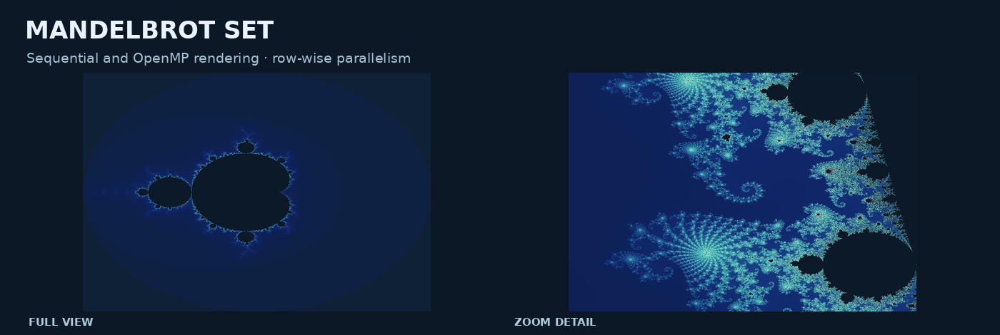
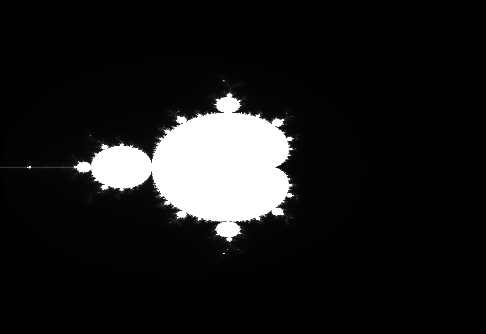
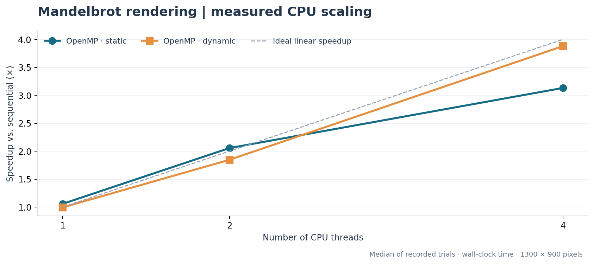
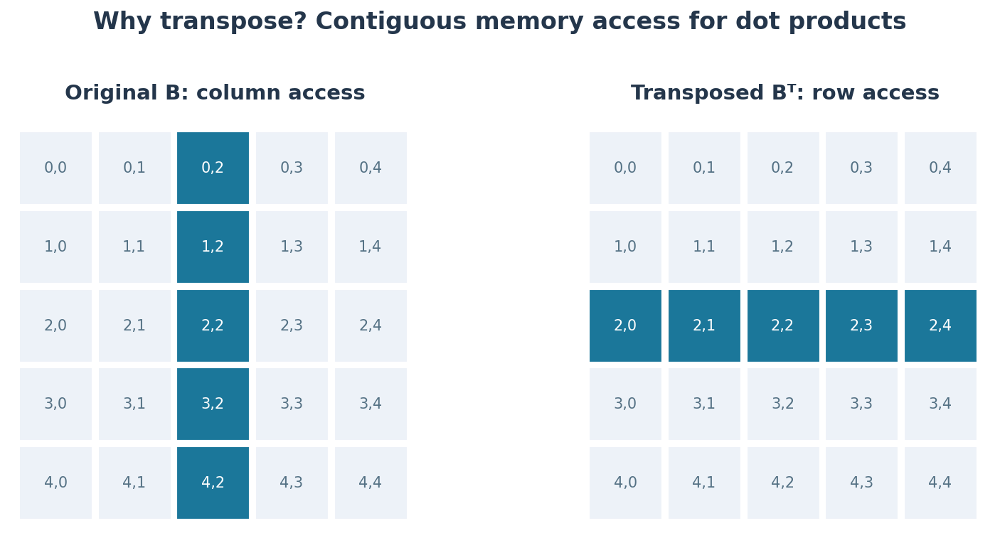
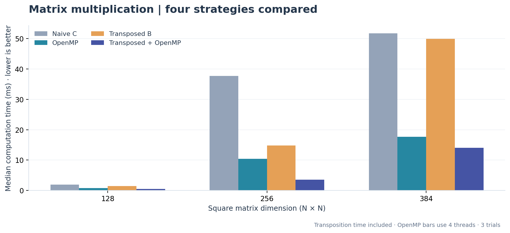

# OpenMP Parallel Computing | Mandelbrot & Matrix Multiplication

**Two C-based computational experiments investigating multithreading, workload scheduling, memory locality, and performance optimization using OpenMP.**

**Project areas:** Parallel Programming · High-Performance Computing · Numerical Computing · Performance Analysis  
**Technologies:** C · OpenMP · GCC · Python · Matplotlib · GNU Make  
**Academic context:** Lebanese American University (LAU) · CSC 447 Parallel Programming and Multi-Cluster Systems



## Overview

Efficient numerical computing requires both **parallel execution** and effective **memory access**. This project explores these concepts through two computational workloads:

1. **Mandelbrot Set Rendering** — distribute independent pixel calculations across CPU threads using OpenMP, evaluate static versus dynamic scheduling, and study execution-time scaling.
2. **Matrix Multiplication Optimization** — compare standard and multithreaded matrix multiplication with an additional optimization based on transposing one input matrix to improve memory locality.

Both experiments include sequential reference implementations, configurable OpenMP execution, timing measurements, and correctness checks. Their results illustrate when parallelism improves performance—and when scheduling or memory overhead can limit the gains.

## 1. Mandelbrot Set | Parallel Rendering

The Mandelbrot set is generated by repeatedly applying a complex-number recurrence for each pixel. Because each pixel can be evaluated independently, the image is well suited to row-wise parallelization.

### Implementation

- Compute a **640 × 480** grayscale image by default, following the original assignment settings.
- Evaluate the Mandelbrot recurrence with a configurable iteration limit.
- Distribute image rows using `#pragma omp parallel for`.
- Compare **static** and **dynamic** OpenMP scheduling and vary the thread count.
- Export a grayscale PGM image; colorized PNG examples provide an alternative presentation of the same computed pixels.
- Measure wall-clock execution time with `omp_get_wtime()` and compute a pixel hash to verify that sequential and parallel rendering produce identical results.

### Computed visualizations

| Standard grayscale render | Color-mapped render |
|---|---|
|  |  |

**Zoom detail:**


### Parallel speedup



The measured run uses a 1300 × 900 image, a 255-iteration limit, and three trials per configuration. The table below reports the median of those trials.

| Execution mode | Threads | Median execution time | Speedup vs. sequential |
|---|---:|---:|---:|
| Sequential | 1 | 97.92 ms | 1.00× |
| OpenMP · static | 2 | 47.63 ms | 2.06× |
| OpenMP · dynamic | 2 | 53.05 ms | 1.85× |
| OpenMP · static | 4 | 31.27 ms | 3.13× |
| OpenMP · dynamic | 4 | 25.24 ms | 3.88× |

Performance varies with system load, CPU scheduling, image size, and thread count. The CSV of individual measurements is included in [`docs/benchmarks/`](docs/benchmarks/).

## 2. Matrix Multiplication | OpenMP & Transposition

Matrix multiplication is a foundational numerical operation used throughout scientific computing, machine learning, and simulation. The order in which matrix elements are accessed can significantly affect cache behavior and execution time.

### Four approaches

| Implementation | Approach |
|---|---|
| **Naive C** | Standard sequential multiplication using a row-by-column dot product |
| **OpenMP** | Parallelize output rows across CPU threads |
| **Transposed B** | Transpose the second matrix to improve contiguous memory access |
| **Transposed B + OpenMP** | Combine memory-locality optimization with shared-memory parallelism |



The transposed implementations access each row of `Bᵀ` sequentially during dot products. **Transposition time is included** in the recorded total time to make comparisons fair.

### Performance comparison



For this benchmark, the two OpenMP versions use **four threads**, and the table reports median execution times (three trials each). Every implementation is checked against the sequential reference result.

| Matrix size | Naive C | OpenMP | Transposed B | Transposed B + OpenMP |
|---|---:|---:|---:|---:|
| 128 × 128 | 1.89 ms | 0.82 ms | 1.42 ms | 0.54 ms |
| 256 × 256 | 37.68 ms | 10.41 ms | 14.79 ms | 3.57 ms |
| 384 × 384 | 51.75 ms | 17.67 ms | 49.96 ms | 14.01 ms |

These measurements demonstrate the potential of combining parallel computation with more cache-friendly data access, while also showing that gains vary by problem size.

## Build and Run

**Recommended:** Linux or Windows with WSL2, GCC with OpenMP support, GNU Make, and Python 3.

### 1. Compile both programs

```bash
make
```

### 2. Render the Mandelbrot set

Sequential:

```bash
./mandelbrot/mandelbrot --mode serial --output mandelbrot-serial.pgm
```

OpenMP with four threads and dynamic scheduling:

```bash
./mandelbrot/mandelbrot --mode omp --threads 4 --schedule dynamic --output mandelbrot-parallel.pgm
```

To experiment with a higher-resolution image:

```bash
./mandelbrot/mandelbrot --mode omp --threads 4 --width 1300 --height 900 --max-iter 255 --output mandelbrot-large.pgm
```

Other supported options include `--schedule static`, `--chunk`, `--center-real`, `--center-imag`, and `--span`. Run `./mandelbrot/mandelbrot --help` for the command-line syntax.

### 3. Compare matrix multiplication strategies

```bash
./matrix/matmul --size 256 --threads 4 --repeats 3
```

The program prints CSV-formatted results for all four strategies, including execution time and numerical correctness.

### 4. Validate correctness

```bash
make test
```

The automated tests compare the sequential and OpenMP Mandelbrot images across multiple thread counts and scheduling strategies, and verify the four matrix-multiplication results for several matrix sizes.

### 5. Reproduce benchmarks and visualizations

```bash
python3 scripts/benchmark.py
python3 -m pip install -r requirements-visuals.txt
python3 scripts/visualize.py
```

The benchmarking script saves raw measurements as CSV files. The visualization script creates the figures from those results and actual output images. Benchmarking and figure generation can be run separately.

To clean compiled binaries:

```bash
make clean
```

## Repository Structure

```text
OpenMP-Mandelbrot-Matrix-Optimization/
├── README.md
├── ACKNOWLEDGMENTS.md
├── Makefile
├── requirements-visuals.txt
├── mandelbrot/
│   └── mandelbrot.c             Sequential and OpenMP image renderer
├── matrix/
│   └── matmul.c                 Four matrix multiplication variants
├── scripts/
│   ├── test_correctness.py      Pixel equivalence and numerical correctness
│   ├── benchmark.py             Wall-clock experiment runner
│   └── visualize.py             Images and benchmark plots
└── docs/
    ├── images/                  Generated figures and rendered outputs
    ├── benchmarks/              Recorded measurements and machine information
    ├── reference/               Course report (student ID redacted)
    └── IMPLEMENTATION_NOTES.md  Methodology and original coursework context
```

## Documentation and Credits

The project was developed from two experiments in **CSC 447: Parallel Programming and Multi-Cluster Systems** at the **Lebanese American University (LAU)**.

The [course assignment report](docs/reference/CSC447-Assignment3-redacted.pdf) documents the original work, while [implementation notes](docs/IMPLEMENTATION_NOTES.md) describe the reproducible experiments, measurement methodology, and source-code organization. See [ACKNOWLEDGMENTS.md](ACKNOWLEDGMENTS.md) for attribution.
